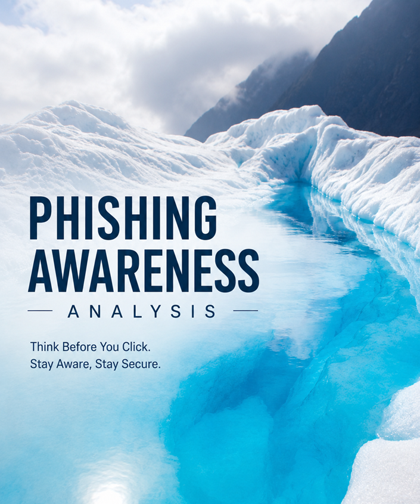

# 🔐 Phishing Awareness Analysis

A cybersecurity awareness project focused on identifying and analyzing phishing attacks, recognizing common warning signs, understanding associated risks, and promoting safe online practices.

## 📌 Project Overview

This project was completed as **Project 3** for the **DecodeLabs Cyber Security Internship**.

The project analyzes different phishing scenarios and demonstrates how attackers use social engineering techniques such as urgency, fake links, spoofed identities, prize scams, and credential-harvesting attempts to trick users.

## 🎯 Objectives

* Identify common phishing attempts
* Detect suspicious links and keywords
* Recognize phishing red flags
* Explain the risks associated with phishing attacks
* Improve cybersecurity awareness
* Promote safe online practices

## 🛡️ What is Phishing?

Phishing is a type of social engineering attack in which attackers use fraudulent emails, messages, or websites to trick users into revealing sensitive information.

Common types covered in this project include:

* Email Phishing
* Spear Phishing
* Smishing
* Vishing
* Clone Phishing
* Business Email Compromise (BEC)

## 🔎 Case Studies

This project analyzes five phishing examples:

### 1. Netflix Subscription Expired

**Red Flags:**

* Urgency
* Suspicious/fake domain
* Login request

**Risk:** Credential theft

**Recommendation:** Verify the sender, inspect URLs carefully, avoid suspicious links, and report the email.

### 2. Bank Account Locked

**Red Flags:**

* Threat of account lock
* Fake verification request

**Risk:** Financial theft

**Recommendation:** Verify the sender and website before providing any information.

### 3. Free iPhone Winner

**Red Flags:**

* Prize scam
* Unknown sender
* Request for personal information/payment

**Risk:** Personal data theft

**Recommendation:** Do not trust unexpected prize messages or provide personal information.

### 4. Microsoft Password Reset

**Red Flags:**

* Fake Microsoft page
* Suspicious password-reset request

**Risk:** Account compromise

**Recommendation:** Verify the sender and access the official service directly instead of using suspicious links.

### 5. Package Delivery Failed

**Red Flags:**

* Fake courier link
* Unexpected delivery message

**Risk:** Identity theft

**Recommendation:** Verify delivery information through the official courier website or application.

## 📸 Project Screenshots

### 🏠 Project Cover

### 🎣 Case Study 1 — Netflix Phishing

### 🏦 Case Study 2 — Bank Account Phishing

### 🎁 Case Study 3 — iPhone Prize Scam

### 🔐 Case Study 4 — Microsoft Password Reset

### 📦 Case Study 5 — Package Delivery Phishing

## 🚩 Common Phishing Red Flags

* Unknown sender
* Misspelled domains
* Urgent requests
* Password or OTP requests
* Unexpected attachments
* Grammar mistakes
* Generic greetings
* Suspicious hyperlinks
* Too-good-to-be-true offers
* Unverified contact information

## 🔒 Security Best Practices

* Enable Multi-Factor Authentication (MFA)
* Use strong passwords
* Keep software updated
* Verify websites before logging in
* Report suspicious emails
* Use antivirus/security software
* Never share OTPs

## 📂 Project Files

| File                              | Description                       |
| --------------------------------- | --------------------------------- |
| `HOME.png`                        | Project cover image               |
| `CASE STUDY 1.png`                | Netflix phishing example          |
| `CASE STUDY 2.png`                | Bank account phishing example     |
| `CASE STUDY 3.png`                | iPhone prize phishing example     |
| `CASE STUDY 4.png`                | Microsoft password-reset example  |
| `CASE STUDY 5.png`                | Package-delivery phishing example |
| `Phishing_Awareness_Analysis.pdf` | Complete project report           |

## 📄 Project Report

The complete analysis and documentation are available in:

**`Phishing_Awareness_Analysis.pdf`**

## 📚 References

* DecodeLabs Project 3 Guidelines
* CISA Phishing Guidance
* NIST Cybersecurity Awareness Resources

## 💡 Conclusion

Phishing attacks often exploit human psychology rather than technical weaknesses. Recognizing warning signs such as fake domains, urgency, suspicious links, and requests for confidential information can help prevent account compromise and data theft.

Security awareness is an important part of protecting users and organizations from phishing attacks.

## 👨‍💻 Author

**Aymen Altaf**

Cyber Security Intern
DecodeLabs

---

⭐ *Think Before You Click. Stay Aware, Stay Secure.*
